<!-- Hero -->
<picture>
  <source media="(prefers-color-scheme: dark)"  srcset="./.github/assets/hero-dark.svg" />
  <source media="(prefers-color-scheme: light)" srcset="./.github/assets/hero-light.svg" />
  
</picture>

<!-- Typing header cũ (tạm ẩn): bỏ comment để dùng
<picture>
  <source media="(prefers-color-scheme: dark)"
    srcset="https://readme-typing-svg.demolab.com?font=Geist+Mono&weight=500&size=40&duration=3000&pause=800&color=f0f6fc&center=true&vCenter=true&width=600&lines=Lien+Hoa+Thuan;Lian+Harman" />
  <source media="(prefers-color-scheme: light)"
    srcset="https://readme-typing-svg.demolab.com?font=Geist+Mono&weight=500&size=40&duration=3000&pause=800&color=1f2328&center=true&vCenter=true&width=600&lines=Lien+Hoa+Thuan;Lian+Harman" />
  
</picture>
<picture>
  <source media="(prefers-color-scheme: dark)"
    srcset="https://readme-typing-svg.demolab.com?font=Geist+Mono&weight=500&size=14&duration=2000&pause=1000&color=9198a1&center=true&vCenter=true&width=520&lines=Freelance+IT+Specialist+%E2%80%94+Can+Tho+City" />
  <source media="(prefers-color-scheme: light)"
    srcset="https://readme-typing-svg.demolab.com?font=Geist+Mono&weight=500&size=14&duration=2000&pause=1000&color=59636e&center=true&vCenter=true&width=520&lines=Freelance+IT+Specialist+%E2%80%94+Can+Tho+City" />
  
</picture>
-->

 

<!-- Social -->

  <a href="https://www.linkedin.com/in/lianharman/">
    <picture>
      <source media="(prefers-color-scheme: dark)"  srcset="https://img.shields.io/badge/LinkedIn-f0f6fc?style=flat-square&logo=data:image/svg%2bxml;base64%2CPHN2ZyB4bWxucz0iaHR0cDovL3d3dy53My5vcmcvMjAwMC9zdmciIHZpZXdCb3g9IjAgMCAyNCAyNCIgZmlsbD0iIzFmMjMyOCI+PHBhdGggZD0iTTIwLjQ0NyAyMC40NTJoLTMuNTU0di01LjU2OWMwLTEuMzI4LS4wMjctMy4wMzctMS44NTItMy4wMzctMS44NTMgMC0yLjEzNiAxLjQ0NS0yLjEzNiAyLjkzOXY1LjY2N0g5LjM1MVY5aDMuNDE0djEuNTYxaC4wNDZjLjQ3Ny0uOSAxLjYzNy0xLjg1IDMuMzctMS44NSAzLjYwMSAwIDQuMjY3IDIuMzcgNC4yNjcgNS40NTV2Ni4yODZ6TTUuMzM3IDcuNDMzYy0xLjE0NCAwLTIuMDYzLS45MjYtMi4wNjMtMi4wNjUgMC0xLjEzOC45Mi0yLjA2MyAyLjA2My0yLjA2MyAxLjE0IDAgMi4wNjQuOTI1IDIuMDY0IDIuMDYzIDAgMS4xMzktLjkyNSAyLjA2NS0yLjA2NCAyLjA2NXptMS43ODIgMTMuMDE5SDMuNTU1VjloMy41NjR2MTEuNDUyek0yMi4yMjUgMEgxLjc3MUMuNzkyIDAgMCAuNzc0IDAgMS43Mjl2MjAuNTQyQzAgMjMuMjI3Ljc5MiAyNCAxLjc3MSAyNGgyMC40NTFDMjMuMiAyNCAyNCAyMy4yMjcgMjQgMjIuMjcxVjEuNzI5QzI0IC43NzQgMjMuMiAwIDIyLjIyMiAwaC4wMDN6Ii8+PC9zdmc+" />
      <source media="(prefers-color-scheme: light)" srcset="https://img.shields.io/badge/LinkedIn-1f2328?style=flat-square&logo=data:image/svg%2bxml;base64%2CPHN2ZyB4bWxucz0iaHR0cDovL3d3dy53My5vcmcvMjAwMC9zdmciIHZpZXdCb3g9IjAgMCAyNCAyNCIgZmlsbD0iI2ZmZmZmZiI+PHBhdGggZD0iTTIwLjQ0NyAyMC40NTJoLTMuNTU0di01LjU2OWMwLTEuMzI4LS4wMjctMy4wMzctMS44NTItMy4wMzctMS44NTMgMC0yLjEzNiAxLjQ0NS0yLjEzNiAyLjkzOXY1LjY2N0g5LjM1MVY5aDMuNDE0djEuNTYxaC4wNDZjLjQ3Ny0uOSAxLjYzNy0xLjg1IDMuMzctMS44NSAzLjYwMSAwIDQuMjY3IDIuMzcgNC4yNjcgNS40NTV2Ni4yODZ6TTUuMzM3IDcuNDMzYy0xLjE0NCAwLTIuMDYzLS45MjYtMi4wNjMtMi4wNjUgMC0xLjEzOC45Mi0yLjA2MyAyLjA2My0yLjA2MyAxLjE0IDAgMi4wNjQuOTI1IDIuMDY0IDIuMDYzIDAgMS4xMzktLjkyNSAyLjA2NS0yLjA2NCAyLjA2NXptMS43ODIgMTMuMDE5SDMuNTU1VjloMy41NjR2MTEuNDUyek0yMi4yMjUgMEgxLjc3MUMuNzkyIDAgMCAuNzc0IDAgMS43Mjl2MjAuNTQyQzAgMjMuMjI3Ljc5MiAyNCAxLjc3MSAyNGgyMC40NTFDMjMuMiAyNCAyNCAyMy4yMjcgMjQgMjIuMjcxVjEuNzI5QzI0IC43NzQgMjMuMiAwIDIyLjIyMiAwaC4wMDN6Ii8+PC9zdmc+" />
      
    </picture>
  </a>
  &nbsp;
  <a href="https://discord.com/users/983724520789655613">
    <picture>
      <source media="(prefers-color-scheme: dark)"  srcset="https://img.shields.io/badge/Discord-f0f6fc?style=flat-square&logo=discord&logoColor=1f2328" />
      <source media="(prefers-color-scheme: light)" srcset="https://img.shields.io/badge/Discord-1f2328?style=flat-square&logo=discord&logoColor=ffffff" />
      
    </picture>
  </a>
  &nbsp;
  <a href="https://www.facebook.com/LianHarman/">
    <picture>
      <source media="(prefers-color-scheme: dark)"  srcset="https://img.shields.io/badge/Facebook-f0f6fc?style=flat-square&logo=facebook&logoColor=1f2328" />
      <source media="(prefers-color-scheme: light)" srcset="https://img.shields.io/badge/Facebook-1f2328?style=flat-square&logo=facebook&logoColor=ffffff" />
      
    </picture>
  </a>
  &nbsp;
  <a href="https://www.tiktok.com/@lian_harman/">
    <picture>
      <source media="(prefers-color-scheme: dark)"  srcset="https://img.shields.io/badge/TikTok-f0f6fc?style=flat-square&logo=tiktok&logoColor=1f2328" />
      <source media="(prefers-color-scheme: light)" srcset="https://img.shields.io/badge/TikTok-1f2328?style=flat-square&logo=tiktok&logoColor=ffffff" />
      
    </picture>
  </a>
  &nbsp;
  <a href="https://x.com/harmanlian">
    <picture>
      <source media="(prefers-color-scheme: dark)"  srcset="https://img.shields.io/badge/X_(Twitter)-f0f6fc?style=flat-square&logo=x&logoColor=1f2328" />
      <source media="(prefers-color-scheme: light)" srcset="https://img.shields.io/badge/X_(Twitter)-1f2328?style=flat-square&logo=x&logoColor=ffffff" />
      
    </picture>
  </a>
  &nbsp;
  <a href="https://gitlab.com/LienThuan04">
    <picture>
      <source media="(prefers-color-scheme: dark)"  srcset="https://img.shields.io/badge/GitLab-f0f6fc?style=flat-square&logo=gitlab&logoColor=1f2328" />
      <source media="(prefers-color-scheme: light)" srcset="https://img.shields.io/badge/GitLab-1f2328?style=flat-square&logo=gitlab&logoColor=ffffff" />
      
    </picture>
  </a>
  &nbsp;
  <a href="mailto:lienthuan2004@gmail.com">
    <picture>
      <source media="(prefers-color-scheme: dark)"  srcset="https://img.shields.io/badge/Email-f0f6fc?style=flat-square&logo=gmail&logoColor=1f2328" />
      <source media="(prefers-color-scheme: light)" srcset="https://img.shields.io/badge/Email-1f2328?style=flat-square&logo=gmail&logoColor=ffffff" />
      
    </picture>
  </a>

<!-- Tech Stack (tạm ẩn): bỏ comment để hiện
 

<picture>
  <source media="(prefers-color-scheme: dark)"  srcset="./.github/assets/section-stack-dark.svg" />
  <source media="(prefers-color-scheme: light)" srcset="./.github/assets/section-stack-light.svg" />
  
</picture>

  <picture>
    <source media="(prefers-color-scheme: dark)"  srcset="https://skillicons.dev/icons?i=ts,js,nextjs,react,nestjs,express,dotnet,tailwind,threejs&theme=dark" />
    <source media="(prefers-color-scheme: light)" srcset="https://skillicons.dev/icons?i=ts,js,nextjs,react,nestjs,express,dotnet,tailwind,threejs&theme=light" />
    
  </picture>

  <picture>
    <source media="(prefers-color-scheme: dark)"  srcset="https://skillicons.dev/icons?i=postgres,mysql,mongodb,docker,git,githubactions,postman,figma,vscode&theme=dark" />
    <source media="(prefers-color-scheme: light)" srcset="https://skillicons.dev/icons?i=postgres,mysql,mongodb,docker,git,githubactions,postman,figma,vscode&theme=light" />
    
  </picture>

-->

 

<!-- Now Playing -->
<picture>
  <source media="(prefers-color-scheme: dark)"  srcset="./.github/assets/section-status-dark.svg" />
  <source media="(prefers-color-scheme: light)" srcset="./.github/assets/section-status-light.svg" />
  
</picture>

  
  <a href="https://discord.com/users/983724520789655613">
    <picture>
      <source media="(prefers-color-scheme: dark)"  srcset="https://lianharman-discord.vercel.app/api/983724520789655613?animatedDecoration=false&showDisplayName=true&showBanner=static&theme=dark&bg=161b22" />
      <source media="(prefers-color-scheme: light)" srcset="https://lianharman-discord.vercel.app/api/983724520789655613?animatedDecoration=false&showDisplayName=true&showBanner=static&theme=light&bg=f6f8fa" />
      
    </picture>
  </a>

 

<!-- Activity -->
<picture>
  <source media="(prefers-color-scheme: dark)"  srcset="./.github/assets/section-activity-dark.svg" />
  <source media="(prefers-color-scheme: light)" srcset="./.github/assets/section-activity-light.svg" />
  
</picture>

  <picture>
    <source media="(prefers-color-scheme: dark)"  srcset="./.github/assets/metrics-stats-dark.svg" />
    <source media="(prefers-color-scheme: light)" srcset="./.github/assets/metrics-stats-light.svg" />
    
  </picture>
  <picture>
    <source media="(prefers-color-scheme: dark)"  srcset="./.github/assets/metrics-activity-dark.svg" />
    <source media="(prefers-color-scheme: light)" srcset="./.github/assets/metrics-activity-light.svg" />
    
  </picture>

<!-- Pacman contribution graph (tạm ẩn): bỏ comment để hiện
<picture>
  <source media="(prefers-color-scheme: dark)"  srcset="https://raw.githubusercontent.com/LienThuan04/LienThuan04/output/pacman-contribution-graph-dark.svg" />
  <source media="(prefers-color-scheme: light)" srcset="https://raw.githubusercontent.com/LienThuan04/LienThuan04/output/pacman-contribution-graph.svg" />
  
</picture>
-->

 

<!-- Favorite Characters
     Cách thêm nhân vật mới:
       1. Bỏ file .gif/.png vào ./.github/assets/
       2. Copy 1 khối <td> ... </td> bên dưới và sửa src + tên
       3. Mỗi hàng (<tr>) nên để tối đa 2 nhân vật cho cân đối
-->
<picture>
  <source media="(prefers-color-scheme: dark)"  srcset="./.github/assets/section-characters-dark.svg" />
  <source media="(prefers-color-scheme: light)" srcset="./.github/assets/section-characters-light.svg" />
  
</picture>

<table align="center" width="100%">
  <tr>
    <td align="center" width="50%">
      
       
      <b>Remielle Dan</b>
    </td>
    <td align="center" width="50%">
      
       
      <b>Ye Shunguang</b>
    </td>
    <!-- Nhân vật tiếp theo: copy khối <td> phía trên vào đây -->
  </tr>
</table>

 

<!-- Footer -->
<picture>
  <source media="(prefers-color-scheme: dark)"  srcset="./.github/assets/footer-dark.svg" />
  <source media="(prefers-color-scheme: light)" srcset="./.github/assets/footer-light.svg" />
  
</picture>

 

<!-- Profile views -->

 
<code>profile views</code>

